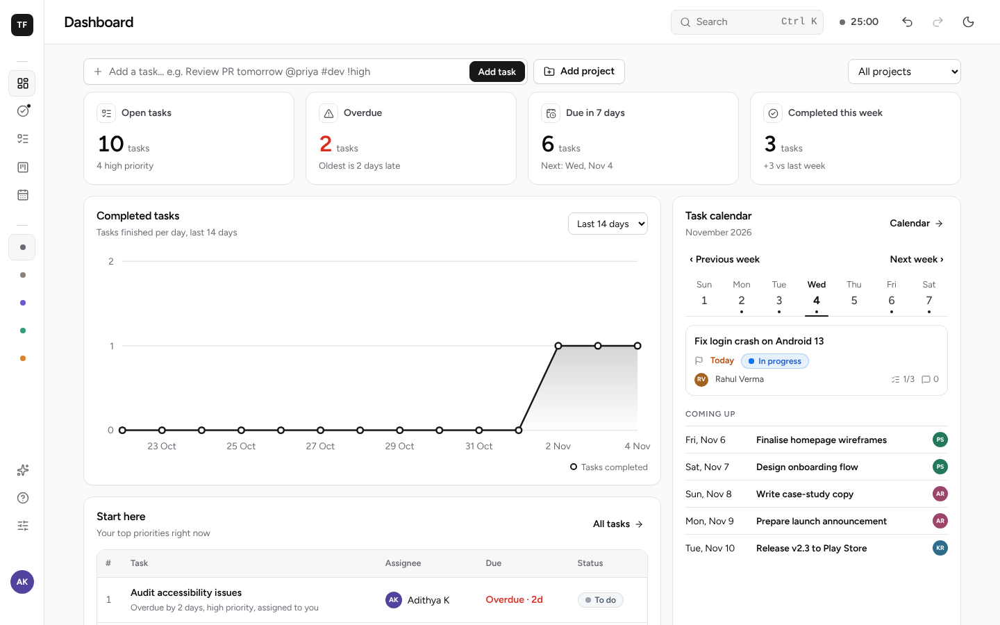
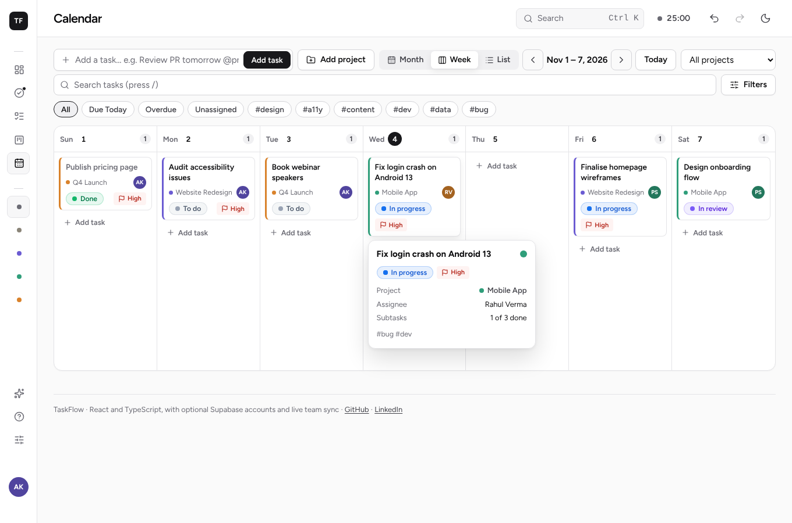
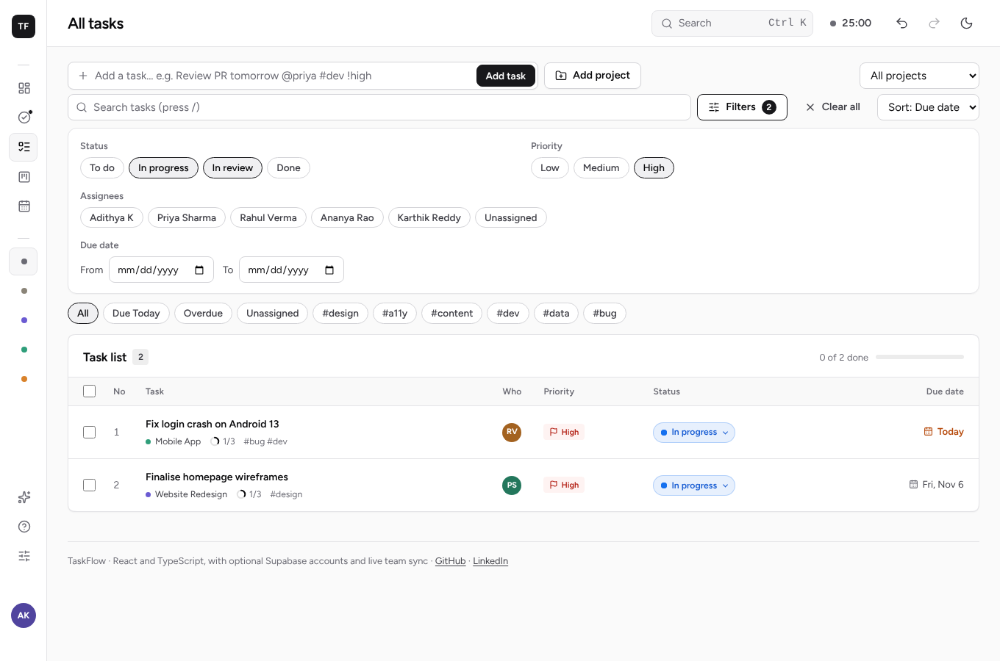
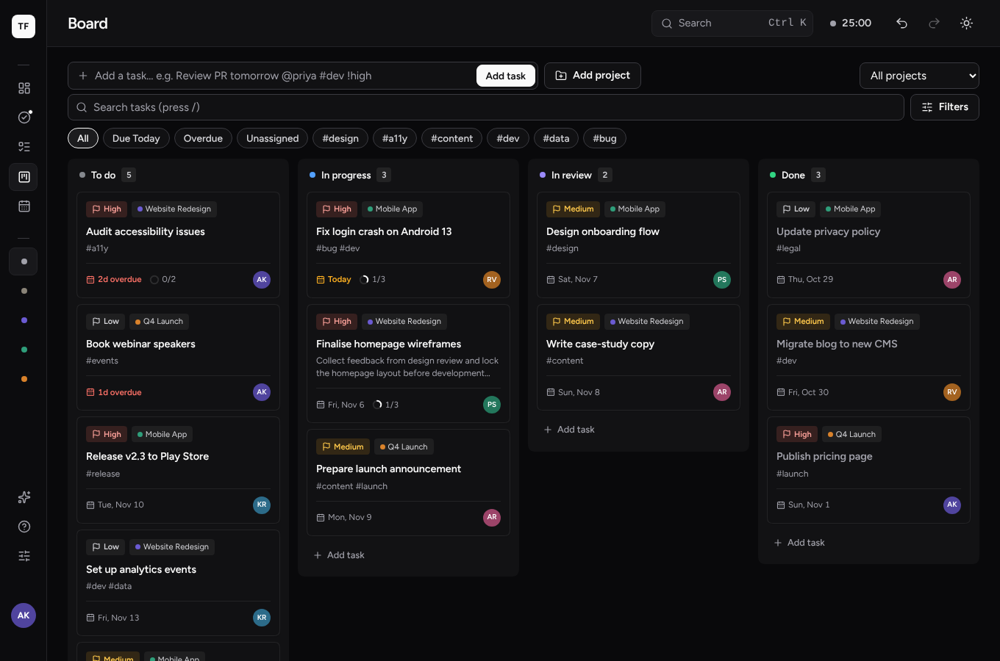
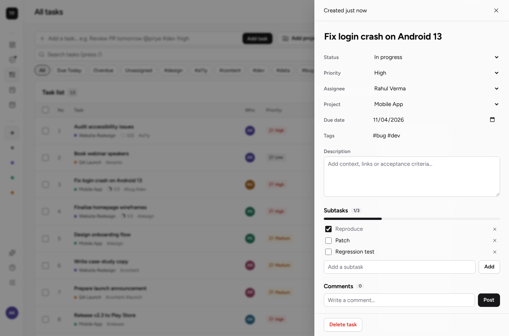
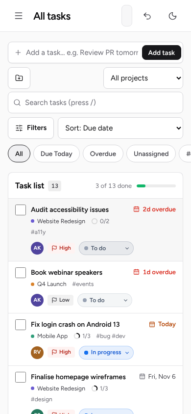
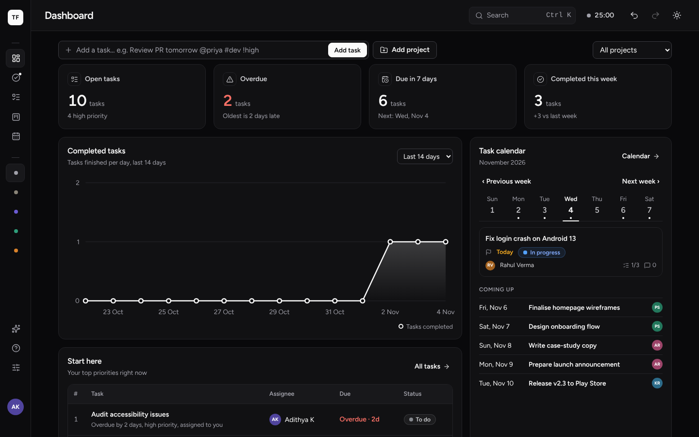

# TaskFlow

A team task manager with accounts, shared workspaces and live sync, built with React, Vite and TypeScript. Supabase provides sign-in, the database and realtime updates.

**Live app:** https://adithyakammara.github.io/taskflow/ (also on Vercel: https://taskflow-sable-beta.vercel.app/)



| Calendar, week view                                  | Search and filters                                   | Board, dark mode                          |
| ---------------------------------------------------- | ---------------------------------------------------- | ----------------------------------------- |
|  |  |  |

| Task drawer                                 | Mobile                                 | Dashboard, dark mode                              |
| ------------------------------------------- | -------------------------------------- | ------------------------------------------------- |
|  |  |  |

## Try it

1. Open the live app and **create an account** (name, email, password), then confirm the email.
2. You land in your own workspace. Press **Add sample data** to see a full board, or add a task.
3. Open **Team → Create invite link** and send it to a teammate. When they join, edit a task in one browser and watch it change in the other.

## Features

**Team work**

- Email and password sign-up, sign-in, password reset and log out. An expired or already-used email link says so on the sign-in screen and points to **Forgot password?** for a new one.
- Workspaces with a switcher in the sidebar; every new account gets one.
- Invite links valid for 7 days, confirmed before joining. Owners can remove members; members can leave.
- Live sync: a teammate's change shows up in about a second, with no refresh.
- Teammates are the assignees, so `@name`, the assignee filter and **My tasks** use real people.

**Planning**

- **Dashboard:** four key numbers (open, overdue, due in 7 days, completed this week), a completed-tasks trend for 7/14/30 days, "Start here" (the three tasks to look at first and why), a week calendar of due tasks, workload and project progress. The **status breakdown** donut shows the completion rate in the centre; hovering a segment or a legend row highlights the other. All charts are hand-built SVG.
- **List:** sortable, with bulk actions. Each task's status is a coloured pill that is also the dropdown to change it; tasks in progress have a pulsing dot.
- **Board:** drag-and-drop columns by status, with keyboard pick-up and drop, and **Add task** at the foot of each column.
- **Calendar:** **Month**, **Week** and **List** layouts (the choice is remembered). Drag a task to another day to move its due date, with **Undo**; hover a task for its details; use **+** on a day to add a task due that day. List groups tasks by date, with undated tasks at the end.
- **Search and filters:** a search box (`/` to focus, `Esc` or ✕ to clear) and a **Filters** panel to pick any mix of statuses, priorities, assignees (including Unassigned) and a due-date range. The button shows how many filters are on, **Clear all** resets them, and quick pills (Due today, Overdue, Unassigned, #tags) sit underneath. Filters apply to the list, board and calendar.
- **Quick add:** type `Review PR tomorrow @priya #dev !high` and the date, assignee, tag and priority are filled in.
- **Task drawer:** status, priority, assignee, due date, tags, description, subtasks, comments and an activity log.

**Speed**

- Undo and redo (50 steps), bulk move, assign and delete, a command palette (`Ctrl K`), a "What next?" ranking and a focus timer.
- Keyboard shortcuts: `N` new task, `/` search, `F` timer, `?` all shortcuts.

**Data and quality**

- JSON backup and restore, and CSV export guarded against spreadsheet formula injection.
- Keyboard accessible with visible focus, reduced-motion support (no pulsing or lifting), light and dark themes, a compact density option and layouts down to phone width. Every page and the main dialogs pass an automated WCAG 2.1 AA scan (axe) in both themes.
- A black-and-white interface where colour is kept for meaning: status, priority, projects and dates. Dialogs are lightly frosted and turn solid when the browser cannot blur or the viewer asks for reduced transparency.

## How it works

| Layer     | What it does                                                                                                                                                                                                             |
| --------- | ------------------------------------------------------------------------------------------------------------------------------------------------------------------------------------------------------------------------ |
| Front end | React 19 and TypeScript (strict), built by Vite. One Zustand store holds the `{ projects, tasks }` document and the view settings (filters, calendar view); views render from it. Tailwind CSS 4 maps the design tokens. |
| Sync      | After each save, only the rows that changed are written. Teammates' changes arrive over Supabase Realtime. Failed writes retry; reconnects catch up.                                                                     |
| Database  | Supabase Postgres. Every table has Row Level Security, so people can only read and write workspaces they belong to.                                                                                                      |
| Auth      | Supabase Auth with email and password. Joining a workspace is only possible through a valid invite (`accept_invite()`).                                                                                                  |
| Hosting   | GitHub Pages at `/taskflow/`, deployed by GitHub Actions when `main` changes. A Vercel project also builds every push (`vercel.json`), serving the app from `/` and a preview for each pull request.                     |

A few choices worth knowing:

- React renders all user text as text, and everything loaded from the database, storage or an imported file passes through `sanitize` first.
- Filtering is one pure function (`filteredTasks` in `src/lib/model/selectors.ts`) shared by every view, so the list, board and calendar always agree.
- Diffing, selectors and filters, the quick-add parser, the undo history and the sync engine have unit tests; the main flows have end-to-end tests.
- When two people edit the same task at the same moment, the last save wins.
- The version 6 to 7 move from plain JavaScript to React is written up in [docs/MIGRATION-V7.md](docs/MIGRATION-V7.md).

## Run it locally

Needs Node 22.12 or newer.

```bash
npm install
```

```bash
npm run dev
```

Then open **http://localhost:5173/taskflow/** (the `/taskflow/` part matters). If 5173 is busy, Vite picks the next free port, so use the address it prints.

**Local mode or cloud mode.** `.env` holds the Supabase project URL and public key. With both values set, the app opens on the sign-in screen and syncs through Supabase; being signed in on the live site does not sign you in on `localhost`. Leave the values empty and it runs in local mode: no accounts, a demo team, and tasks saved only in that browser. To work in local mode without editing `.env`, create a `.env.local` (git-ignored) with both values set to nothing:

```bash
VITE_SUPABASE_URL=
VITE_SUPABASE_ANON_KEY=
```

**Use your own Supabase project.** Fork the repository, create a free Supabase project, run [`supabase/schema.sql`](supabase/schema.sql) in its SQL Editor, set the **Site URL** and **Redirect URLs** under Authentication → URL Configuration to every address the app is served from, and put your project's URL and publishable key in `.env`. [docs/SUPABASE.md](docs/SUPABASE.md) walks through each step, including what to check when email links open a 404.

## Project structure

```
index.html
src/
  main.tsx, App.tsx  entry point and routes
  app/               store (Zustand), actions, routes
  components/        app frame (sidebar, header, toolbar with quick add, search, filters and
                     calendar controls), shared pieces, toast
  features/          dashboard, tasks (list, drawer, status pills), board, calendar (month, week,
                     list), palette and shortcuts, settings dialogs, auth (sign-in, workspaces, team)
  lib/               logic with no React in it: config, types, model (sanitise, parser,
                     selectors, diff), store (history, storage), supabase (client, sync), utils
  styles/            design tokens, Tailwind setup, view and dashboard styles, self-hosted font
supabase/            schema.sql: tables, Row Level Security, triggers, invite function
tests/               unit tests (Vitest)
e2e/                 end-to-end and accessibility tests (Playwright, axe)
```

## Scripts

| Command                           | What it does                                                 |
| --------------------------------- | ------------------------------------------------------------ |
| `npm run dev`                     | Serve the app locally with hot reload                        |
| `npm run build` / `preview`       | Production build into `dist/`, and serve that build          |
| `npm test`                        | Unit tests (Vitest)                                          |
| `npm run e2e`                     | End-to-end and accessibility tests (Playwright)              |
| `npm run typecheck`               | TypeScript, strict                                           |
| `npm run lint`                    | ESLint                                                       |
| `npm run format` / `format:check` | Prettier                                                     |
| `npm run check`                   | Lint, format check, typecheck, unit tests and build together |

## How changes land

Nothing is committed straight to `main`. Every change goes through a branch and a pull request:

1. Branch off the latest `main` (`git switch -c my-change origin/main`), commit, and push the branch.
2. Open a pull request into `main`. GitHub Actions runs `npm run check` on Node 22 and 24 plus the end-to-end and accessibility tests (`.github/workflows/ci.yml`), and Vercel posts a preview deployment.
3. Merge once every check is green. The merge deploys `main` to GitHub Pages (`.github/workflows/pages.yml`).

## Roadmap

- [x] Dashboard, list, board and calendar views with tests and CI
- [x] Accounts, workspaces, invite links and live team sync
- [x] React, Vite and TypeScript front end with a refreshed design (v7)
- [x] Month, week and list calendar with drag-to-reschedule; multi-select filters and search
- [ ] Optional due times on tasks, for an hourly day view
- [ ] Roles beyond owner and member (for example, view-only guests)
- [ ] Rename and delete workspaces
- [ ] Email notifications when a task is assigned to you
- [ ] Audit log and reports

## Credits

Built by [Adithya Kammara](https://github.com/AdithyaKammara) · [LinkedIn](https://linkedin.com/in/adithyakammara)

Font: [Figtree](https://github.com/erikdkennedy/figtree), under the SIL Open Font License (copy in `src/styles/fonts/`). Licensed under MIT.
